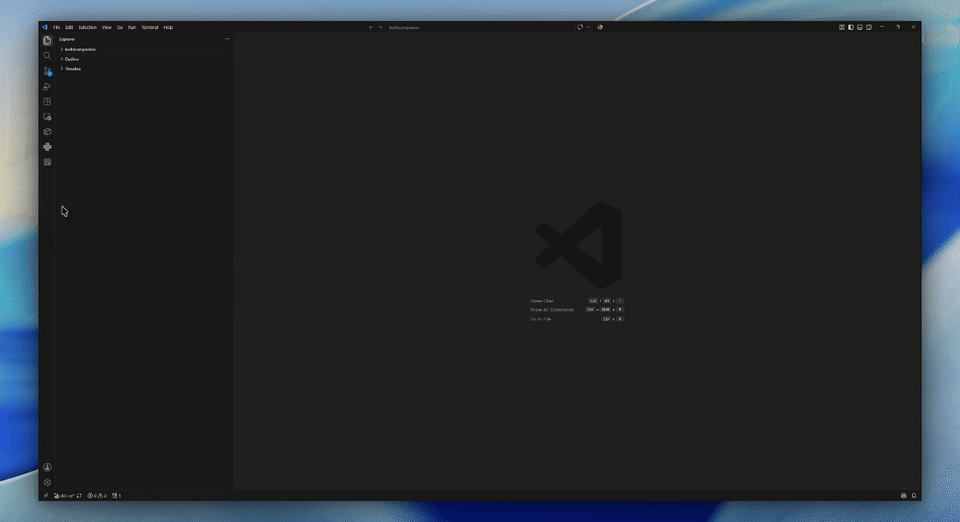

# BuildCompanion for AWS CodeBuild

[](LICENSE)
[](https://github.com/parad0x1k/buildcompanion/actions/workflows/ci.yml)
[](https://marketplace.visualstudio.com/items?itemName=parad0x1k.buildcompanion)

BuildCompanion is a native VS Code extension to trigger, monitor, and debug AWS CodeBuild projects directly from your editor.

> BuildCompanion is an independent, community-built open-source project. It is not affiliated with, endorsed by, or sponsored by Amazon Web Services (AWS). "AWS" and "CodeBuild" are trademarks of Amazon.com, Inc. or its affiliates.

## Demo

### Trigger a Single Build


### Batch Deploy Multiple Projects



## Privacy & Telemetry

This extension makes **no network calls outside the AWS endpoints implied by the active profile and region**. It collects **no telemetry** and ships **no analytics SDK**. The `telemetry.telemetryLevel` VS Code setting is respected by default (no-op since no telemetry is sent). All AWS credentials live in your local AWS configuration files or in VS Code's encrypted Secret Storage; they are never written to logs, never transmitted to third parties, and never persisted in plaintext.

## Compliance & FIPS Notice

This extension is a community tool and has **not** been developed, tested, or validated against FIPS 140-2/140-3, FedRAMP, DoD IL4/5, CJIS, or ITAR control requirements. The `codebuild.useFipsEndpoint` setting routes AWS API requests to AWS FIPS-validated **service endpoints** (e.g. `codebuild-fips.us-gov-west-1.amazonaws.com`), but the VS Code / Electron / Node.js runtime hosting this extension uses standard (non-validated) OpenSSL for client-side TLS. Users operating under a client-side FIPS mandate should not rely on this extension for regulated workloads.

## Documentation Map

- This README is focused on installation, daily workflows, and troubleshooting.
- For an exhaustive capability matrix (including niche and edge-case behavior), see [FEATURE_REFERENCE.md](FEATURE_REFERENCE.md).

## Installation

### Option 1: Install from Marketplace

1. Open VS Code.
2. Open Extensions.
3. Search for "BuildCompanion for AWS CodeBuild".
4. Install and reload VS Code.

### Option 2: Install from VSIX

1. Open VS Code.
2. Open Extensions.
3. Select "Install from VSIX...".
4. Choose a package file such as `buildcompanion-1.1.0.vsix`.
5. Reload VS Code.

## Requirements

- VS Code: `^1.85.0`
- Node.js: `>=20.0.0` (development only)
- AWS account access to CodeBuild and CloudWatch Logs
- One of the supported auth sources:

1. Local AWS profile (`~/.aws/config`, `~/.aws/credentials`)
2. AWS SSO profile
3. Environment credentials
4. Temporary credentials stored through extension command

### Minimum IAM Permissions

Grant enough permissions for the APIs used by the extension:

- `codebuild:ListProjects`
- `codebuild:ListBuilds`
- `codebuild:ListBuildsForProject`
- `codebuild:BatchGetBuilds`
- `codebuild:StartBuild`
- `codebuild:StopBuild`
- `codebuild:RetryBuild` (required to retry a build from Build History)
- `codebuild:BatchGetProjects` (required to view project environment variables)
- `codebuild:UpdateProject` (required to save project environment variable changes)
- `logs:GetLogEvents`

If a permission is missing, the failed action shows a short notification and logs a detailed message naming the exact IAM action to add — see the `BuildCompanion` output channel.

## Quick Start

1. Open the BuildCompanion activity bar view.
2. Select an AWS profile.
3. Select an AWS region.
4. Refresh projects.
5. Trigger a build from a project row.
6. Monitor active builds and open logs from the same view.

## What This Extension Supports

- Profile discovery across local, SSO, environment, and temporary credentials.
- Region switching with persisted selection.
- CodeBuild project listing, trigger, status monitoring, cancel, and history.
- Retry a past build from Build History, or directly from a build-failure notification, using its original source version and project configuration.
- Build concurrency prompts (Wait, Trigger anyway, Cancel) with queue handling.
- Batch deployment for selected projects with per-project branch memory and fallback branch.
- Dedicated, scrollable per-build log viewer (its own editor tab) with throttled updates and a line-retention cap, so very large log streams stay responsive.
- `View Full Log` loads a build's entire CloudWatch log history (from the very beginning) into a second, unbounded read-only tab — useful once the tailing viewer has truncated older lines.
- Log output (in both the viewer and the output channel) has ANSI color codes and carriage-return progress-bar overwrites cleaned up, so colorized/progress-reporting build tool output stays readable.
- Build statuses in the TreeView are shown as short, human-readable labels (e.g. "In Progress", "Timed Out") instead of raw AWS status codes.
- Build History timestamps can be toggled between your detected local timezone and UTC, with the preference remembered across sessions.
- View and edit a project's CodeBuild environment variables from a settings (gear) icon.
- CloudWatch log streaming with recoverable retry/backoff behavior.
- Failure summary extraction from recent log lines.
- Search and filtering of projects in TreeView (comma-separated terms match any, e.g. `api,fe,middleware`).
- Failed Builds section tracking builds you triggered via BuildCompanion that ended in failure, with one-click retry.
- Scope-aware state for profile, region, branches, selections, queued items, and destructive-action blocks.
- Output channel logging with identifier redaction by default and configurable retention.
- Permission-denied failures name the specific missing IAM action where applicable.

## Command Surface

All contributed commands are available through the Command Palette. Several are also available in the TreeView toolbar or context menus.

| Command ID | Title | Typical Location | Purpose |
| --- | --- | --- | --- |
| `codebuild.switchProfile` | Switch Profile | Settings row, Command Palette | Change active AWS profile |
| `codebuild.switchRegion` | Switch Region | Settings row, Command Palette | Change active AWS region |
| `codebuild.refresh` | Refresh | Toolbar, context menu, Command Palette | Reload profiles and projects |
| `codebuild.searchProjects` | Search Projects | Toolbar, Command Palette | Filter project list (comma-separated terms match any) |
| `codebuild.clearProjectSearch` | Clear Project Search | Toolbar, Command Palette | Clear filter text |
| `codebuild.toggleAutoRefresh` | Toggle Auto-Refresh | Settings row, toolbar, Command Palette | Enable or disable build polling |
| `codebuild.toggleBuildTimeDisplay` | Toggle Build Time Display (Local/UTC) | Settings row, Command Palette | Switch Build History timestamps between local time and UTC |
| `codebuild.setTemporaryCredentials` | Set AWS Credentials | Settings row, Command Palette | Store temporary credentials in SecretStorage |
| `codebuild.triggerBuild` | Trigger Build | Project inline action, context menu, Command Palette | Start build for a project |
| `codebuild.cancelBuild` | Cancel Build | Active build inline action, Command Palette | Stop a selected in-progress build |
| `codebuild.cancelAllBuilds` | Cancel All Builds | Toolbar, Command Palette | Cancel in-progress and queued operations in current scope |
| `codebuild.viewLogs` | View Logs | Build history inline action, Command Palette | Open the per-build log viewer and stream CloudWatch logs |
| `codebuild.viewFullLogs` | View Full Log | Build history inline action, log viewer toolbar, Command Palette | Load a build's entire CloudWatch log history into a readable, unbounded tab |
| `codebuild.retryBuild` | Retry Build | Build history inline action, Command Palette | Start a new build reusing a past build's source version |
| `codebuild.editEnvironmentVariables` | Edit Environment Variables | Project inline action (gear icon), Command Palette | View/add/edit/remove a project's CodeBuild environment variables |
| `codebuild.selectAllProjects` | Select All Visible Projects | Toolbar (conditional), Command Palette | Select visible projects for batch deploy |
| `codebuild.deployAll` | Deploy Selected Projects | Toolbar, projects root context menu, Command Palette | Start sequential batch deployment |
| `codebuild.setBranch` | Set Branch | Project inline action, context menu, Command Palette | Save scoped branch mapping |
| `codebuild.clearAllBranches` | Clear All Saved Branches | Toolbar (conditional), Command Palette | Clear all saved branch mappings |
| `codebuild.openTerminal` | Open AWS Setup Terminal | Command Palette, setup message action | Open terminal for AWS CLI setup |

## Authentication and Region Behavior

### Profile Sources

The extension builds a merged profile list from:

1. `AWS_CONFIG_FILE` or `~/.aws/config`
2. `AWS_SHARED_CREDENTIALS_FILE` or `~/.aws/credentials`
3. Environment credentials (`AWS_ACCESS_KEY_ID` and `AWS_SECRET_ACCESS_KEY`) as virtual profile `environment`
4. Temporary profiles remembered in VS Code SecretStorage

### Temporary Credentials

Use `Set AWS Credentials` to store:

- profile name
- access key ID
- secret access key
- optional session token
- ISO8601 expiration timestamp

Notes:

- Profile name `environment` is reserved.
- Existing non-temporary AWS profiles cannot be overwritten by temporary profile names.
- Expired, malformed, or incomplete temporary credentials are automatically purged and the extension falls back to standard provider resolution.

### Region Resolution

Default region order:

1. Persisted selection in VS Code global state
2. Selected profile region
3. `AWS_REGION` or `AWS_DEFAULT_REGION`
4. `us-east-1`

Supported regions are fixed in this version. See [FEATURE_REFERENCE.md](FEATURE_REFERENCE.md) for the full list.

## Daily Workflows

### Trigger a Single Build

1. Select profile and region.
2. Trigger build from a project.
3. Use saved branch, suggested Git branch, or manual branch input.
4. If another build is already in progress for the same project and scope, choose one:

- Wait (queue)
- Trigger anyway
- Cancel

### Deploy Selected Projects (Batch)

1. Select projects from the Projects section. Checkboxes stay visible even as you narrow a search down to one match, so you can build up a selection across several searches.
2. Run Deploy Selected Projects.
3. Provide delay in seconds (`>= 1`).
4. If some projects do not have saved branches, optionally provide a fallback branch.
5. Confirm deployment preview and start.

Selecting more than `codebuild.batchDeploy.maxSelectedProjects` (default `25`) projects at once, whether by checkbox or Select All, is blocked with a warning instead of silently truncating the selection.

### View Logs and Failure Summary

1. Open logs from a history row, active build, or command.
2. Logs stream into a dedicated, scrollable editor tab for that build (opened beside your current editor) so you can keep watching while you work elsewhere. The same lines are also written to the shared `BuildCompanion` output channel for continuity.
3. The viewer keeps the most recent `codebuild.logsViewer.maxLines` lines (default `10000`) and shows a truncation notice once older lines are dropped, so extremely long-running builds stay responsive.
4. Closing the log viewer tab stops streaming for that build (no more CloudWatch API calls are made on your behalf).
5. For failed builds, a failure summary is extracted from recent log lines and appended to the viewer and the output channel.
6. ANSI color codes and carriage-return progress-bar overwrites are cleaned up before display, so colorized or progress-reporting build tool output (e.g. `docker`, `npm`, `pip`) reads as plain text instead of stray control characters.

### View the Entire Log History

1. Click the `View Full Log` button in the log viewer tab's toolbar, or use the `View Full Log` inline action on a Build History / Active Builds row.
2. The build's entire available CloudWatch log history is fetched from the very beginning (not just the recent tail) and shown in a second, unbounded read-only tab, leaving your original tailing viewer untouched.
3. A cancellable progress notification reports how many lines have been fetched so far, and the tab fills in incrementally as pages arrive.
4. This fetch is capped at `codebuild.logsViewer.maxFullLogLines` (default `50000` lines) as a safety limit; if reached, the tab's footer says so and names the setting to raise.

### Retry a Build

1. Expand a project under Build History (or find a completed build in Active Builds).
2. Use the retry inline action (or `Retry Build` from the Command Palette) on a completed build.
3. Confirm the prompt, which names the branch/source version being retried when known. A new build starts using the original build's source version and the project's current configuration.
4. A notification confirms the branch/source version the retry actually used, resolved from the `RetryBuild` response (shown as `default` when the project's default source version was used).
5. If a build is already in progress for that project, you are asked to confirm before starting a second, concurrent build.
6. A failed build's completion notification also offers a `Retry Build` button that starts this same flow immediately, without needing to find the build in Build History.
7. Builds that failed are also listed in the **Failed Builds** section (below Build History) — but only ones that BuildCompanion itself started (Trigger Build, Retry Build, batch Deploy, or an auto-started queued build); builds already running before the extension started watching them won't appear there. Each row has `Retry Build`, `View Logs`, and `Dismiss Failed Build` actions, a `Clear Failed Builds` toolbar button clears the list, and an entry disappears automatically once that project's next build succeeds. The list is capped at the 10 most recent per profile/region and persists across restarts.

### Edit Project Environment Variables

1. Use the settings (gear) inline action on a project row (or `Edit Environment Variables` from the Command Palette).
2. The current environment variables configured on the CodeBuild project are fetched and listed.
3. Add, edit, or remove variables, choosing a type (`PLAINTEXT`, `PARAMETER_STORE`, or `SECRETS_MANAGER`) for each.
4. Choose `Save changes to AWS` to apply, or dismiss without saving to discard your edits. Nothing is written to AWS until you explicitly save.

### Cancel Active Operations in Scope

`Cancel All Builds` for current profile and region performs scope-aware cancellation:

- cancels active batch deployment in scope
- removes queued Wait deployments in scope
- stops in-progress builds in scope
- leaves builds in other scopes untouched

## Monitoring and Notifications

- Activation no longer waits on AWS: the tree view and all commands are available immediately, and populate in the background once profile/project discovery finishes (useful on slow networks, cold credential/SSO resolution, or Dev Containers).
- Active build polling is enabled by default, starting at `codebuild.monitor.pollIntervalMs` (default `5000` ms; raise this if your account sees CodeBuild API throttling).
- Adaptive polling can automatically increase poll interval when many builds are active.
- Completion notifications are shown for success, failure, timeout, fault, and stopped states, and name the branch/source version that was built.
- Failure notifications include a `Retry Build` button to immediately restart the same build without leaving the notification.
- Failed builds that BuildCompanion itself triggered are also tracked in the Failed Builds section until dismissed, cleared, or superseded by a successful build for that project.
- If auto-refresh is disabled, completion popups and queued Wait progression are paused.
- Stale in-progress builds (long-running) raise warning notifications.

## Configuration

| Setting | Default | Description |
| --- | --- | --- |
| `codebuild.monitor.adaptivePolling` | `true` | Increase polling interval with higher active-build count to reduce pressure |
| `codebuild.monitor.pollIntervalMs` | `5000` | Base interval (ms) between active-build status checks (`3000` to `15000`); raise if AWS throttles requests |
| `codebuild.monitor.maxConcurrentStatusChecks` | `6` | Maximum parallel status-check concurrency (`1` to `20`) |
| `codebuild.performanceDiagnostics.enabled` | `false` | Emit periodic monitor performance diagnostics |
| `codebuild.logging.maxOutputLines` | `8000` | Output retention threshold; set `0` to disable automatic clearing |
| `codebuild.logging.verbose` | `false` | Disable identifier redaction in output logs |
| `codebuild.logsViewer.maxLines` | `10000` | Maximum lines retained in the per-build log viewer before older lines are truncated (minimum `500`) |
| `codebuild.logsViewer.maxFullLogLines` | `50000` | Safety cap on total lines fetched by `View Full Log` (minimum `1000`) |
| `codebuild.batchDeploy.maxSelectedProjects` | `25` | Maximum projects selectable at once (checkboxes or Select All) for a batch deployment (`1` to `100`) |
| `codebuild.localTimeZone` | `""` (auto-detect) | IANA time zone (e.g. `America/New_York`) used for the "Local" build time display; see [Troubleshooting](#local-build-times-dont-change-in-a-dev-containerwslssh-remote) |

## Security Notes

- Temporary credentials are stored in VS Code SecretStorage, not plaintext workspace files.
- Logs redact profile, region, and build identifiers by default unless verbose logging is enabled.
- Temporary credential entries are validated and purged when invalid or expired.

## Troubleshooting

### No profiles shown

- Run `aws configure` or `aws sso login`.
- Check `AWS_CONFIG_FILE` and `AWS_SHARED_CREDENTIALS_FILE` values.

### SSO session expired

- Reauthenticate with `aws sso login` for the active profile.

### Projects fail to refresh

- Confirm profile/region credentials and IAM permissions.
- Use Retry or Switch Profile when prompted.
- If refresh fails, destructive actions are blocked in that scope until profile switch.

### Queued builds do not start

- Ensure auto-refresh is enabled.

### Log stream unavailable

- Ensure CloudWatch Logs permissions are granted.
- Some builds may complete without available log stream metadata.

### Local build times don't change in a Dev Container/WSL/SSH remote

- BuildCompanion is a workspace extension, so its host process (and the "Local" timezone it detects) runs on the remote/container machine, not your physical machine. Minimal container images commonly default their system clock to UTC, which makes the `Build Times: Local`/`Build Times: UTC` toggle look like it has no effect.
- Set `codebuild.localTimeZone` to your actual IANA time zone (e.g. `America/New_York`) to override auto-detection.

## Known Limitations

- Queue and selection state are in-memory only and are not persisted across extension reload.
- Build history is loaded lazily per project (on expand), not preloaded globally.
- Region list is fixed in this release.
- Only one batch deployment can be active at a time in the extension session.
- Git branch suggestions use the first workspace folder and may be limited in complex multi-root workspaces.

## Development

Install dependencies and compile:

```bash
npm install
npm run compile
```

Available scripts:

- `npm run compile`
- `npm run watch`
- `npm test` (compiles, then runs the automated test suite in a real VS Code instance)
- `npm run audit:production`
- `npm run audit:production:json`
- `npm run audit:production:fix-dry-run`

See [CONTRIBUTING.md](CONTRIBUTING.md) for full contributor setup and testing details.

## Additional Reference

For complete command/menu conditions, environment variable behavior, hard limits, retry/backoff details, and scope semantics, see [FEATURE_REFERENCE.md](FEATURE_REFERENCE.md).

## License

MIT. See [LICENSE](LICENSE).
